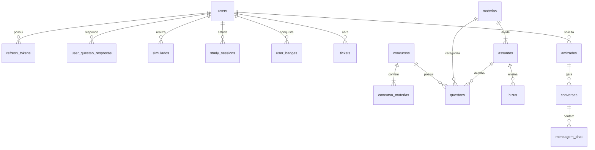
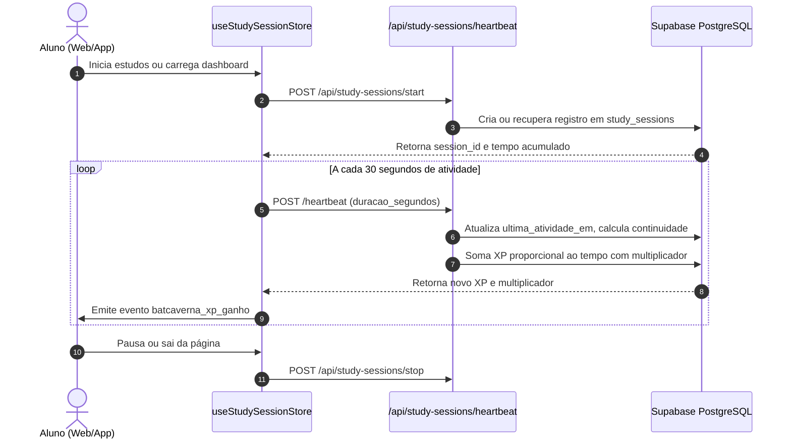
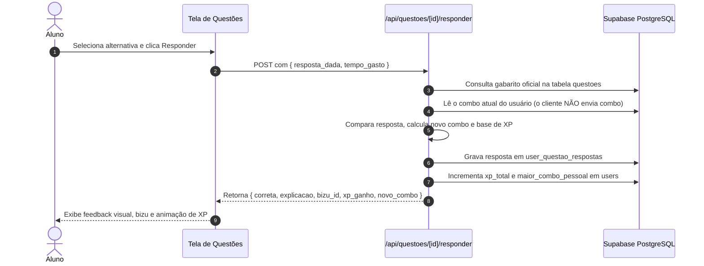

# 🦇 BatCaverna — Central de Operações de Concursos Militares e ENEM

> **Manual Definitivo de Arquitetura, Engenharia e Operação da Plataforma.**  
> Este documento é o guia oficial para desenvolvedores e ferramentas de IA entenderem profundamente o projeto, garantindo desenvolvimento consistente, seguro e padronizado.

---

## 📑 Sumário

1. [Visão Geral do Projeto](#-visão-geral-do-projeto)
2. [Arquitetura do Monorepo](#-arquitetura-do-monorepo)
3. [Guia Passo a Passo: Instalação e Execução](#-guia-passo-a-passo-instalação-e-execução)
4. [Pacotes Compartilhados (`packages/`)](#-pacotes-compartilhados-packages)
5. [Frontend Web (`apps/web`)](#-frontend-web-appsweb)
6. [Backend, Autenticação e APIs](#-backend-autenticação-e-apis)
7. [Banco de Dados e Migrações (`supabase/`)](#-banco-de-dados-e-migrações-supabase)
8. [Aplicativo Mobile (`apps/mobile`)](#-aplicativo-mobile-appsmobile)
9. [Fluxos de Dados e Ciclos de Vida](#-fluxos-de-dados-e-ciclos-de-vida)
10. [Variáveis de Ambiente](#-variáveis-de-ambiente)
11. [Scripts de Manutenção e Ferramentas](#-scripts-de-manutenção-e-ferramentas)
12. [🛡️ Guia Anti-Erros / Regras de Ouro](#️-guia-anti-erros--regras-de-ouro-para-devs-e-ias)

---

## 🎯 Visão Geral do Projeto

A **BatCaverna** é uma plataforma de estudos gamificada, imersiva e de alta performance, projetada para estudantes que prestam concursos militares de elite e o ENEM:

- 🛩️ **Aeronáutica**: EEAR (Sargentos Especialistas), AFA (Oficiais Aviadores/Intendentes/Infantes), EPCAR (Cadetes do Ar)
- ⚓ **Marinha**: EAM (Aprendizes-Marinheiros), Colégio Naval (CN), EFOMM (Oficiais da Marinha Mercante)
- ⚔️ **Exército**: ESA (Sargentos das Armas), EsPCEx (Cadetes do Exército), IME (Engenharia Militar)
- 🎓 **ENEM**: Exame Nacional do Ensino Médio (todas as áreas do conhecimento)

### Pilares da Plataforma
- **Gamificação Militar**: 15 patentes/níveis (de *Recruta das Sombras* a *Rei da Batcaverna*), XP contínuo, combos de acertos, badges e rankings semanais/mensais/gerais.
- **Sessões de Estudo em Tempo Real**: Rastreador de tempo ativo de estudo com cálculo de continuidade, multiplicador de dedicação e envio de heartbeats sincronizados ao banco.
- **Banco de Questões e Bizus**: Resolução interativa com gabarito comentado, bizus táticos associados, filtros dinâmicos por assunto e relatórios de desempenho por matéria.
- **Simulados Cronometrados**: Provas cronometradas configuradas nos pesos oficiais das bancas examinadoras, com correção em lote e blindagem de gabarito até a finalização.
- **Arsenal de Redação**: Temas oficiais de bancas militares e ENEM, contador com validação de 4 parágrafos e guia tático interativo de conectivos e macroestrutura.
- **Música para Foco**: Player integrado (Dynamic Island no topo) com acervo de música clássica em domínio público (streaming nativo sem travamentos) e criação de playlists.
- **Comunidade & Squad**: Busca de soldados, pedidos de amizade, chat com moderação em tempo real e mini-perfis customizáveis com badges e banners.
- **Painel Administrativo & Moderação**: Centro de comando isolado para gestão de usuários, dossiê militar do estudante, suporte com tickets táticos, importação de questões e métricas de infraestrutura.

---

## 🏗️ Arquitetura do Monorepo

O projeto é configurado como um **Monorepo** gerenciado por **Turborepo** e **NPM Workspaces** (`apps/*`, `packages/*`).

```
batcaverna/
├── apps/
│   ├── web/                     # Aplicação Web (Next.js 16 App Router + React 19)
│   └── mobile/                  # Aplicativo Nativo Android (Bare React Native 0.74.5)
├── packages/
│   ├── types/                   # Contratos TypeScript, entidades e enums do domínio
│   ├── ui/                      # Design Tokens (paleta BatCaverna, forças militares, níveis)
│   ├── utils/                   # Cálculos de XP, combos, formatadores de data/tempo e validações
│   └── config/                  # tsconfig.base.json e regras compartilhadas
├── supabase/
│   ├── migrations/              # Scripts SQL estruturais de versionamento
│   └── seeds/                   # Carga de dados (concursos, matérias, questões, teoria e bizus)
├── scripts/                     # Utilitários de ingestão de questões e script de resgate admin
├── turbo.json                   # Configuração de pipelines do Turborepo
└── package.json                 # Orquestrador de dependências e scripts do monorepo
```

---

## 🚀 Guia Passo a Passo: Instalação e Execução

### Pré-requisitos
- **Node.js**: Versão `>= 20.0.0`
- **NPM**: Versão `>= 10.0.0`
- **Git**
- *(Opcional - Apenas para compilar o APK localmente)*: JDK 17 e Android SDK com `ANDROID_HOME` configurado.

---

### 1. Clonar e Instalar Dependências
Na raiz do monorepo (`batcaverna/`):
```bash
npm install
```
Isso instalará as dependências de todos os workspaces (`apps/web`, `apps/mobile`, `packages/*`).

---

### 2. Configurar as Variáveis de Ambiente
Copie o arquivo de exemplo e insira suas credenciais do Supabase:
```bash
cp apps/web/.env.example apps/web/.env.local
```

---

### 3. Configurar o Banco de Dados (Supabase)
1. Acesse o seu projeto no console do [Supabase](https://supabase.com).
2. Abra o **SQL Editor**.
3. Execute o arquivo **`supabase/migrations/000_setup_completo_batcaverna.sql`** deste repositório. Ele cria todo o schema, tabelas, enums, triggers, RLS e dados básicos.
4. *(Opcional para carga didática completa)*: Execute os seeds em `supabase/seeds/` conforme o [Guia de Seeds](./supabase/seeds/LEIA-ME.md).

---

### 4. Executar a Aplicação Web (Next.js)
```bash
npm run dev:web
```
Acesse a aplicação no navegador em [http://localhost:3000](http://localhost:3000).

---

### 5. Executar o Aplicativo Mobile (React Native / Android)
Para iniciar o Metro Bundler:
```bash
npm run dev:mobile
```
Para inicializar o app diretamente no emulador ou dispositivo Android conectado via USB:
```bash
cd apps/mobile
npm run android
```

---

### 6. Compilar o APK Release do Android
Para gerar o pacote de instalação `.apk`:
```bash
npm run build:apk
```
O arquivo gerado estará disponível em:
`apps/mobile/android/app/build/outputs/apk/release/app-release.apk`

---

## 📦 Pacotes Compartilhados (`packages/`)

Os pacotes em `packages/` são compilados diretamente pelo TypeScript e consumidos pelos apps via workspaces locais:

### 1. `@batcaverna/types` (`packages/types`)
Contém todos os contratos de dados compartilhados entre frontend, backend e mobile:
- **Enums**: `UserRole`, `Forca`, `NivelEnsino`, `NivelImpacto`, `Dificuldade`, `ProgressoStatus`, `RankingPeriodo`, `TicketStatus`, `NotificacaoTipo`, etc.
- **Interfaces de Domínio**: `User`, `UserMiniPerfil`, `Concurso`, `Materia`, `Assunto`, `Questao`, `Simulado`, `Bizu`, `StudySession`, `RankingEntry`, `Ticket`, `ReleaseItem`, etc.
- **Contratos de Resposta da API**: `ApiResponse<T>`, `AuthTokens`, `PaginatedResponse<T>`.

### 2. `@batcaverna/ui` (`packages/ui`)
Define os **Design Tokens** universais da marca BatCaverna:
- **Cores Oficiais**:
  - Fundo escuro primário: `#0B0B0F`, `#121218`, `#16161E` (cards), `#1E1E28` (elevado).
  - Amarelo-ouro BatCaverna: `#F5C518` (destaques, badges, botões táticos).
  - Cores por Força: Aeronáutica (`#0047AB`), Marinha (`#0A2540`), Exército (`#2E5A1E`), ENEM (`#E65100`).
- **Níveis de Gamificação**: Tabela de 15 níveis com títulos e pisos mínimos de XP.

### 3. `@batcaverna/utils` (`packages/utils`)
Funções puras e determinísticas para regras de negócio:
- **Gamificação**: `calcularNivel(xp)`, `calcularXpQuestao(acertou, combo)`, `calcularBonusCombo(combo)`.
- **Formatação**: `formatarTempoEstudo(segundos)`, `formatarCronometro(segundos)`, `formatarDataHoraVersao(isoDate)`.
- **Validação**: `validarEmail(email)`, `validarSenha(senha)`, `validarApelido(apelido)`.
- **Deduplicação**: `normalizarTextoParaHash(str)` para evitar questões duplicadas no armazém.

### 4. `@batcaverna/config` (`packages/config`)
Configurações TypeScript estendidas (`tsconfig.base.json`).

---

## 🌐 Frontend Web (`apps/web`)

### Stack Tecnológica
- **Framework**: [Next.js 16.3+](https://nextjs.org/) (App Router, Turbopack)
- **Biblioteca Core**: [React 19](https://react.dev/)
- **Estilização**: [Tailwind CSS v4](https://tailwindcss.com/) (`@tailwindcss/postcss`)
- **Gerenciamento de Estado**: [Zustand 5](https://zustand-demo.pmnd.rs/) com persistência em `localStorage`
- **Renderização Gráfica**: SVGs otimizados sem dependências pesadas externas.
- **Criptografia & JWT**: `jose`

### Mapa de Rotas e Páginas
```
apps/web/src/app/
├── page.tsx                     # Landing Page pública com apresentação e atalho de acesso
├── auth/page.tsx                # Central de Autenticação (Login, Cadastro, Recuperação de Senha)
├── (privado)/                   # ROUTE GROUP: um único layout.tsx monta o AppShell para toda a área logada
│   ├── dashboard/page.tsx       # "Plano de Hoje": o que estudar agora, radar de fraqueza
│   ├── concursos/page.tsx       # Catálogo de Concursos Militares e seleção de foco
│   ├── concursos/[sigla]/       # trilha · assuntos · estatísticas · TAF
│   ├── questoes/page.tsx        # Banco Interativo de Questões com filtros dinâmicos
│   ├── simulado/page.tsx        # Prova cronometrada, repartida no peso da banca
│   ├── redacao/page.tsx         # Temas militares reais, estrutura dissertativa e guia de conectivos
│   ├── ranking/page.tsx         # Hall da Fama (Geral, Semanal, Mensal e por Concurso)
│   ├── bizus/page.tsx           # Anotações táticas, fórmulas e resumos de alto impacto
│   ├── chat/page.tsx            # Comunicação entre soldados e conversas diretas
│   ├── tickets/page.tsx         # Central de Suporte e abertura de chamados
│   ├── perfil/page.tsx          # Estatísticas do estudante, edição de perfil e banner
│   ├── progresso/page.tsx       # Histórico: streak, tempo, XP, evolução e simulados
│   ├── caderno/page.tsx         # Caderno de erros com anotação por questão
│   ├── revisoes/page.tsx        # Fila da repetição espaçada
│   ├── cronograma/page.tsx      # Plano de estudo por semana até a data da prova
│   ├── musica/page.tsx          # Acervo de música, favoritos e playlists
│   └── admin/                   # Painel Administrativo Isolado (usuários, moderação, armazém)
├── novidades/                   # Diário público de atualizações da plataforma (alunos)
├── termos/                      # Termos de Uso
├── privacidade/                 # Política de Privacidade (LGPD)
└── contato/                     # Canal de contato oficial
```

### Gerenciamento de Estado Global (Stores)
1. **`useAuthStore`** (`src/stores/auth-store.ts`):
   - Mantém usuário ativo, `accessToken` e `refreshToken`.
   - Persiste sessão em `localStorage` sob a chave `'batcaverna-auth'`.
   - Fornece o helper **`fetchWithAuth(url, options)`**: intercepta respostas `401 Unauthorized`, solicita um novo token via `/api/auth/refresh` silenciosamente e repete a chamada sem deslogar o usuário.
2. **`useStudySessionStore`** (`src/stores/study-session-store.ts`):
   - Gerencia o cronômetro de estudo ativo.
   - Envia `heartbeat` periódico para `/api/study-sessions/heartbeat`.
   - Atualiza multiplicadores de continuidade e incrementa XP em tempo real.
3. **`usePlayerStore`** (`src/stores/player-store.ts`):
   - Gerencia o player singleton de áudio nativo e controle da Dynamic Island.

### Proteção de Rotas com Proxy (`src/proxy.ts`)
O proxy do Next.js (antigo middleware) intercepta todas as rotas protegidas (`/dashboard`, `/questoes`, `/simulado`, `/admin`, etc.):
- Lê o token via cookie `bat_access_token` ou header `Authorization: Bearer <token>`.
- Valida o token com `verifyAccessToken(token)`.
- Se o token for inválido/inexistente, redireciona para `/auth?redirect=<rota>`.
- Para rotas `/admin`, valida se o claim `role === 'admin'`.

---

## 🔒 Backend, Autenticação e APIs

> [!CAUTION]
> **AVISO CRÍTICO SOBRE AUTENTICAÇÃO:**
> O projeto **NÃO UTILIZA** o serviço de Auth padrão do Supabase (GoTrue/`supabase.auth`).
> A autenticação é **100% customizada**, gerenciada pela própria API Next.js e armazenada na tabela `users` do PostgreSQL.
> **NUNCA** chame `supabase.auth.signInWithPassword()` ou `supabase.auth.signUp()`.

### Arquitetura de Autenticação (`src/lib/auth.ts`)
- **Armazenamento de Senha**: **PBKDF2-HMAC-SHA256**, 210.000 iterações com sal exclusivo por usuário gerado via Web Crypto (`crypto.subtle`). Armazenado em `users.senha_hash` no formato `pbkdf2$<iterações>$<sal>$<hash>`.
- **Access Token (JWT)**: Emitido via biblioteca `jose` (`HS256`), assinado com `JWT_SECRET`, com duração padrão de **10 horas** (36.000s) para garantir estudo ininterrupto.
- **Refresh Token**: Gerado aleatoriamente com bytes criptográficos, armazenado com hash na tabela `refresh_tokens` e vinculado ao cookie seguro HTTP-only `bat_refresh_token`.
- **Compatibilidade Dupla**: Suporta Cookies (SSR e páginas web) e Headers Bearer (clientes mobile e chamadas client-side).

### Padrão dos Clientes Supabase (`src/lib/supabase.ts`)
O backend adota duas instâncias de conexão com o banco de dados:

1. **`createServerSupabaseClient()`** (Uso exclusivo nas API Routes):
   - Utiliza a variável de ambiente **`SUPABASE_SERVICE_ROLE_KEY`**.
   - Bypassa as políticas de RLS no nível do banco para operações administrativas validadas pelo JWT.
2. **`createBrowserSupabaseClient()`** (Uso client-side):
   - Utiliza a variável de ambiente **`NEXT_PUBLIC_SUPABASE_ANON_KEY`**.
   - Respeita estritamente o Row Level Security (RLS) habilitado no banco.

---

## 🗄️ Banco de Dados e Migrações (`supabase/`)

O banco de dados é um PostgreSQL hospedado no Supabase.

### Como aplicar as migrações:
Para subir o banco completo de uma só vez em um novo ambiente Supabase:
1. Acesse o **SQL Editor** no painel do Supabase.
2. Copie o conteúdo integral do arquivo **`supabase/migrations/000_setup_completo_batcaverna.sql`**.
3. Execute o script. Ele é idempotente e realiza a criação de todas as tabelas, índices, enums e RLS.

### Diagrama Entidade-Relacionamento


---

## 📱 Aplicativo Mobile (`apps/mobile`)

### Arquitetura Híbrida
O aplicativo mobile é um projeto **Bare React Native 0.74.5** nativo com pasta `android/` configurada. Ele atua como um wrapper otimizado da plataforma:

1. **WebView de Alta Performance (`react-native-webview`)**:
   - Aponta por padrão para a aplicação Web (`PLATFORM_URL = "https://estudo-tan.vercel.app"`).
   - Suporte a subframes e reprodução de áudio contínuo.
2. **Resiliência e Fallback Offline**:
   - Protegido por um `ErrorBoundary` nativo no topo da árvore de componentes, evitando crash total do app.
   - Tratamento de falhas de conexão de rede com tela customizada e botão "Tentar Novamente ⚡".
3. **Integração com Sistema Operacional**:
   - Suporte ao botão de voltar físico do Android (`BackHandler.addEventListener('hardwareBackPress')`).
   - Interceptação de links de protocolos externos (`whatsapp:`, `tel:`, `mailto:`, `market:`).
4. **Geração do APK Release**:
   - Compilação nativa via Gradle: `npm run build:apk`.
   - Gera o binário em `apps/mobile/android/app/build/outputs/apk/release/app-release.apk`.

---

## 🔄 Fluxos de Dados e Ciclos de Vida

### 1. Fluxo de Sessão de Estudo e Heartbeat


### 2. Fluxo de Resolução de Questão


---

## ⚙️ Variáveis de Ambiente

Crie o arquivo **`apps/web/.env.local`** baseado em `apps/web/.env.example`:

| Variável | Obrigatória? | Descrição | Exemplo |
| :--- | :---: | :--- | :--- |
| `NEXT_PUBLIC_SUPABASE_URL` | Sim | URL base do seu projeto Supabase | `https://xyz.supabase.co` |
| `NEXT_PUBLIC_SUPABASE_ANON_KEY` | Sim | Chave pública anônima (com RLS) | `eyJhbGciOi...` |
| `SUPABASE_SERVICE_ROLE_KEY` | Sim | Chave de serviço administrativa (bypassa RLS nas APIs) | `eyJhbGciOi...` |
| `JWT_SECRET` | Sim | Chave secreta usada para assinar e validar tokens JWT | `sua_chave_super_secreta_jwt` |
| `JWT_ACCESS_EXPIRATION` | Não | Duração em segundos do token de acesso (Padrão: 36000 = 10h) | `36000` |
| `JWT_REFRESH_EXPIRATION`| Não | Duração em segundos do refresh token (Padrão: 36000 = 10h) | `36000` |
| `NEXT_PUBLIC_APP_URL` | Sim | URL raiz da aplicação Web para redirecionamentos | `http://localhost:3000` |
| `RESEND_API_KEY` | Não | Chave de API do Resend para envio de e-mails transacionais | `re_123456789` |
| `EMAIL_FROM` | Não | Remetente dos e-mails disparados pela plataforma | `noreply@batcaverna.com.br` |

> [!CAUTION]
> **Segurança de Chaves e JWT:**
> Nunca comite chaves no código-fonte. Certifique-se de que `JWT_SECRET` e `SUPABASE_SERVICE_ROLE_KEY` estejam configuradas no painel da Vercel para produção e no `.env.local` para desenvolvimento local.

---

## 🛠️ Scripts de Manutenção e Ferramentas

O monorepo disponibiliza scripts de contingência e manutenção na pasta `scripts/`:

```bash
# Resgate de emergência do Administrador (Break-Glass)
npm run admin:rescue

# Pipeline de parser e extração de questões
python scripts/parse_questoes.py --stats   # Relatório de extração das provas
python scripts/gerar_seed_sql.py           # Gera seeds SQL a partir das questões parseadas
python scripts/auditar_gabaritos.py        # Validação de integridade dos gabaritos
```

---

## 🛡️ Guia Anti-Erros / Regras de Ouro para Devs e IAs

Siga rigorosamente estas diretrizes para não quebrar a arquitetura do projeto:

> ### 1. NUNCA utilize Supabase Auth
> O projeto utiliza autenticação própria com JWT (`jose`) e senhas com hash PBKDF2 na tabela `users`. Métodos como `supabase.auth.signInWithPassword`, `supabase.auth.getUser` ou `@supabase/auth-helpers` **NÃO FUNCIONAM** neste ecossistema. Utilize sempre os endpoints `/api/auth/*`.

> ### 2. No Next.js 16, SEMPRE aguarde `params` com `await`
> No Next.js 16 App Router, os parâmetros de rotas dinâmicas são Promises:
> ```typescript
> export async function GET(req: NextRequest, { params }: { params: Promise<{ id: string }> }) {
>   const { id } = await params;
> }
> ```

> ### 3. Rotas de API devem usar `createServerSupabaseClient()`
> Todas as tabelas do Supabase possuem RLS ativado. As rotas internas de API (`src/app/api/**`) **devem** chamar `createServerSupabaseClient()` para usar a chave de serviço (`service_role`).

> ### 4. Chamadas autenticadas no Client devem usar `fetchWithAuth()`
> No frontend web, quando precisar fazer requisições a rotas privadas, importe e use `fetchWithAuth` de `@/stores/auth-store`. Ele anexa o header `Authorization: Bearer <token>` e renova automaticamente o token de acesso caso expire.

> ### 5. Não quebre as fronteiras do Monorepo
> Se você precisar de um novo tipo TypeScript, adicione-o em `packages/types/src/index.ts`. Se precisar de uma nova função matemática ou utilitária, adicione-a em `packages/utils/src/index.ts`. Nunca duplique código entre `web` e `mobile`.

> ### 6. Blindagem de Gabarito em Simulados
> Ao criar ou listar questões durante um simulado ativo (`/api/simulados/start`), **nunca envie os campos `resposta_correta` ou `explicacao` para o frontend**. O gabarito só deve ser consultado no servidor no momento em que o aluno finalizar a prova.

> ### 7. Toda rota logada vai dentro do Route Group `app/(privado)/`
> O route group `(privado)` possui o único `layout.tsx` que monta o `AppShell`. **Nunca crie `layout.tsx` individual por rota privada**, para evitar desmontar a barra lateral, o player de música e os cronômetros de estudo ao navegar.

> ### 8. Versionamento Controlado da Plataforma (Somente sob autorização)
> - **NÃO** alterar a versão da plataforma sem autorização explícita do usuário.
> - Ao receber autorização, classificar e sincronizar os 4 arquivos canônicos:
>   1. `apps/web/src/data/changelog.ts` (`CURRENT_APP_VERSION` e `CHANGELOG_HISTORY`)
>   2. `apps/mobile/android/app/build.gradle` (`versionCode` e `versionName`)
>   3. `apps/mobile/app.json` (`version`)
>   4. `apps/mobile/package.json` (`version`)
> - **NUNCA** criar arquivos de migração SQL apenas para atualizar versão na tabela `app_info`. A rota `/api/app-info` detecta e atualiza o Supabase automaticamente.

> ### 9. Versionamento Exclusivo e Isolado do Painel de Admin (Confidencial)
> - O **Painel de Admin possui uma versão própria e isolada** (`CURRENT_ADMIN_VERSION` em `apps/web/src/data/admin-changelog.ts`), completamente desvinculada da versão pública dos alunos.
> - **Sigilo Absoluto de Moderação:** Melhorias de moderação, ferramentas internas, auditoria, novos módulos de gestão, tickets de suporte e dossiês de alunos **NUNCA** devem ser descritos no `changelog.ts` público dos alunos nem exibidos no modal de novidades (`MissedUpdatesModal`). É mandatório que os alunos não saibam de alterações e ferramentas internas de moderação.
> - Quando houver melhorias exclusivas no painel de administração:
>   1. Atualize **apenas** a versão do admin em `admin-changelog.ts` (`CURRENT_ADMIN_VERSION`) e registre no `ADMIN_CHANGELOG_HISTORY`.
>   2. **NÃO** incremente a versão pública dos estudantes (`CURRENT_APP_VERSION`), evitando disparar pop-ups desnecessários aos alunos.

---

### 🦇 BatCaverna — Rumo à Aprovação!
*Dúvidas, sugestões de novos concursos ou problemas técnicos? Abra um Ticket na aba de Suporte da plataforma.*
